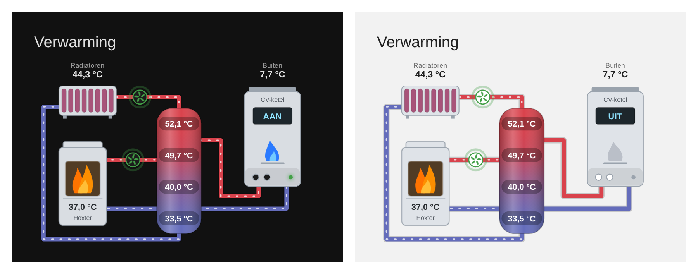

# Heating Card

Een custom Lovelace-card voor Home Assistant die je verwarmingsinstallatie als schema toont:
een **buffervat** met temperatuurgradiënt, **radiatoren**, een **haard** (houtkachel) en een **CV-ketel** (gaswandketel).



## Wat de card doet

- **Buffervat met kleurverloop.** De kleur wordt live berekend uit de temperaturen van je buffersensoren (blauw = koud, rood = warm).
- **Leidingen in de juiste kleur.** De aanvoer kleurt mee met de bovenkant van de buffer, de retour met de onderkant.
- **Bewegende stroming** in de leidingen zolang de bijbehorende pomp aan staat.
- **Draaiende pompen.** De schoep draait in de stroomrichting en pulseert groen zolang de pomp aan staat.
- **Vlammen** in de haard als die actief is, en een blauwe **gasvlam** in de CV-ketel als die brandt.
- **Klikbaar.** Tik op een temperatuur, pomp of toestel om het *more-info*-venster te openen.
- **Werkt met je thema** (licht en donker) en schaalt mee met de breedte van de card.
- **Visuele editor** in het dashboard; YAML werkt ook.
- **Optionele onderdelen.** Laat je een onderdeel (bv. `boiler`) weg, dan verdwijnt het met zijn leidingen uit het schema.

## Installatie

### Via HACS (aangepaste repository)

1. HACS → menu (⋮) → *Aangepaste repositories*.
2. Voeg `https://github.com/vermeerschn/homeassistant-heating-card` toe als type **Dashboard**.
3. Installeer **Heating Card** en herlaad je browser.

### Handmatig

1. Kopieer `dist/heating-card.js` naar `/config/www/heating-card.js`.
2. Ga naar *Instellingen → Dashboards → ⋮ → Bronnen* en voeg toe:
   - URL: `/local/heating-card.js`
   - Type: **JavaScript-module**
3. Herlaad je browser (eventueel met cache legen).

## Configuratie

```yaml
type: custom:heating-card
title: Verwarming
min_temp: 25          # temperatuur die volledig blauw is
max_temp: 55          # temperatuur die volledig rood is
buffer:
  name: Buffer        # optioneel
  entities:           # van BOVEN naar ONDER
    - sensor.sensor_buffer_3
    - sensor.sensor_buffer_2
    - sensor.sensor_buffer_1
    - sensor.sensor_buffer_0
radiators:
  name: Radiatoren
  temperature: sensor.sensor_warmtevraag_radiatoren
  pump: binary_sensor.sensor_pompradiatoren
stove:
  name: Hoxter
  temperature: sensor.sensor_hoxter
  pump: binary_sensor.sensor_pomphoxter
  active: input_boolean.hoxter_haard_actief
boiler:
  name: CV-ketel
  outdoor: sensor.sensor_buitenvoeler
  # active: binary_sensor.cv_ketel_brander      # optioneel: vlam + stroming
  # temperature: sensor.cv_ketel_aanvoer        # optioneel: getoond op het display
```

### Opties

| Optie | Standaard | Omschrijving |
|---|---|---|
| `title` | – | Titel boven de card |
| `min_temp` | `20` | Temperatuur die als volledig "koud" wordt getoond |
| `max_temp` | `60` | Temperatuur die als volledig "warm" wordt getoond |
| `cold_color` | `#2f80ed` | Kleur voor koud (hex) |
| `hot_color` | `#eb3b3b` | Kleur voor warm (hex) |
| `decimals` | `1` | Aantal decimalen bij numerieke waarden |
| `buffer.entities` | – | Lijst met temperatuursensoren, van boven naar onder. Elk item mag ook `{entity: ..., name: ...}` zijn |
| `buffer.name` | – | Naam onder het buffervat |
| `radiators.temperature` / `.pump` / `.name` | – | Temperatuur, pomp en naam van het radiatorcircuit |
| `stove.temperature` / `.pump` / `.active` / `.name` | – | Haard. Zonder `active` branden de vlammen zolang de pomp draait |
| `boiler.temperature` / `.outdoor` / `.active` / `.name` | – | CV-ketel: temperatuur op het display (bv. aanvoer), buitentemperatuur erboven, brander actief |

"Aan" betekent een state `on`, `heat`, `heating`, `running`, `active` of `true`, of een getal groter dan 0.
Je kunt dus ook een vermogenssensor als `active` of `pump` gebruiken.

### Uiterlijk aanpassen met card-mod of je thema

| CSS-variabele | Betekenis |
|---|---|
| `--heating-card-device-color` | Kleur van de toestellen |
| `--heating-card-device-stroke` | Randkleur van de toestellen |
| `--heating-card-pump-on-color` | Kleur van een actieve pomp of LED |
